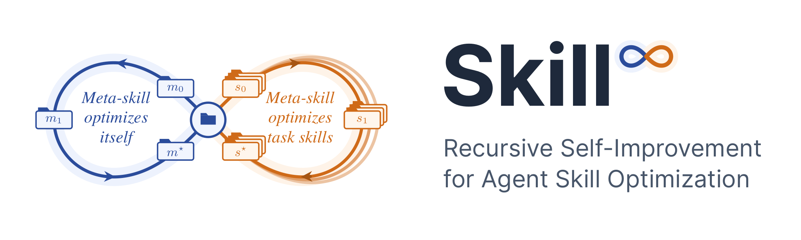
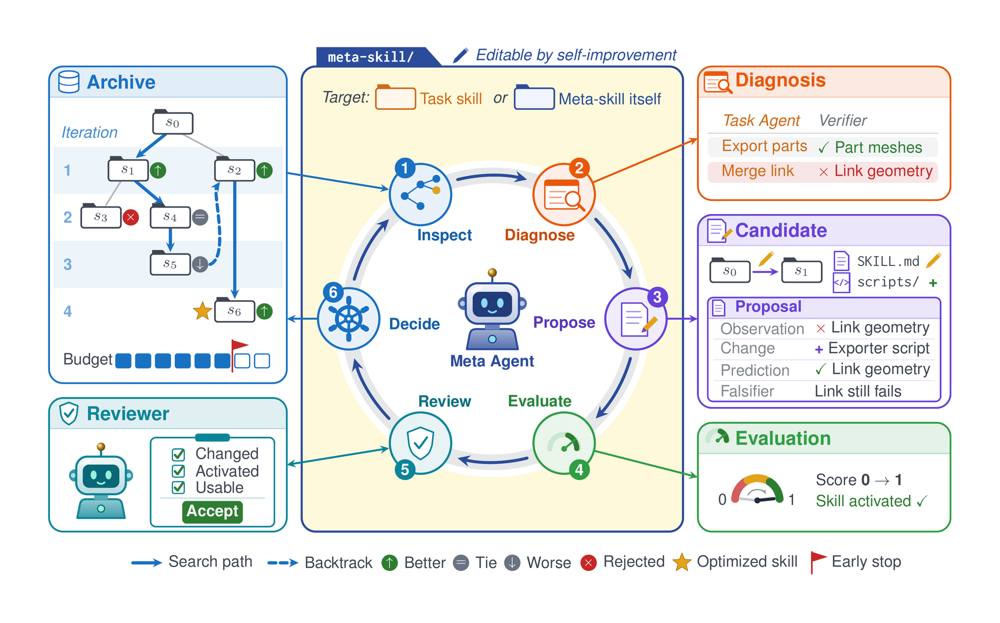

<p align="center">
  
</p>

<p align="center">
  <a href="https://arxiv.org/abs/2610.35434"></a>
  <a href="LICENSE"></a>
  <a href="https://agentskills.io/specification"></a>
</p>

<p align="center"><b>A meta-skill that optimizes agent skills, and itself.</b></p>

## ♾️ Key Idea

In Skill∞, a meta agent follows a **meta-skill** to optimize task skills and optimizes the meta-skill itself with the same procedure, so skill optimization becomes recursively self-improving.

## 🧭 How It Works

<p align="center">
  
</p>

- **Recursively Self-Improving Skill Optimization**
- **Agent-Led Optimization**
- **Decoupling Meta-Skill from Task Skills**
- **Native Skill Discovery at Both Levels**

## 🚧 Status

The code will be released soon.

## 📄 Citation

If Skill∞ helps your research, please cite our paper:

```bibtex
@article{tao2026skill,
  title   = {Skill$^{\infty}$: Recursive Self-Improvement for Agent Skill Optimization},
  author  = {Tao, Wangcheng and Yan, Zhanglu and Wu, Han and Wong, Weng-Fai},
  journal = {arXiv preprint arXiv:2610.35434},
  year    = {2026}
}
```
